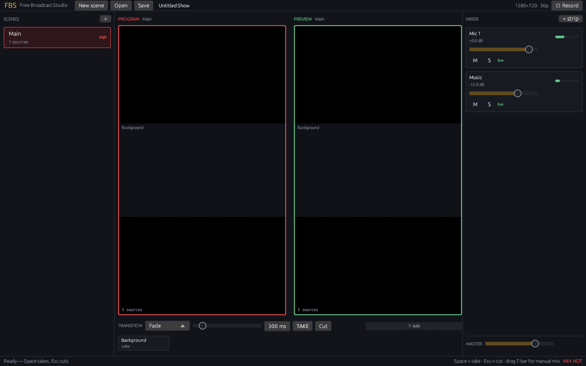

# FBS — Free Broadcast Studio

An original Rust live-production app for Windows, built around the workflow broadcasters
expect from OBS Studio, with the bus/overlay ideas from vMix, Smix and CastDeckLocal.

Target machine: HP EliteBook 840 G2, i5-5200U, 8 GB RAM, 500 GB HDD, Windows X-Lite 11 Pro.

## What exists today

The control room runs. Scenes, buses, the T-bar and the mixer work end to end; capture
frames are still placeholders, drawn as labelled blocks inside each monitor.

| Piece | Crate | State |
| --- | --- | --- |
| Scene graph, source transforms, blend modes | `fbs-core` | working |
| Program / Preview buses, T-bar, transitions | `fbs-core` | working |
| Audio mixer strips, solo/mute, meters | `fbs-core` | working |
| Project save/load (JSON, versioned) | `fbs-core` | working |
| Control-room UI (egui): monitors, scene list, T-bar, strips | `fbs-app` | working |
| GPU compositor: layers, rotation, crop, opacity, blend modes | `fbs-render` | working |
| GPU transitions: cut, fade, slide, wipe | `fbs-render` | working |
| Capture: DXGI desktop, Media Foundation camera, WASAPI audio | `fbs-capture` | next |
| Encoder: QSV H.264 via bundled ffmpeg sidecar | `fbs-encode` | next |



## Windows test build

Download **`fbs-windows.zip`** from the project root, unzip anywhere, and run:

| Program | What it does |
| --- | --- |
| `gpu_report.exe` | Run first. Confirms the Intel GPU is being used, not a fallback. |
| `fbs.exe` | The control room. Space = take, Esc = cut, drag the T-bar. |
| `render_project.exe` | Renders the demo show to PNGs via the real GPU compositor. |

## Develop it

```
cargo test -p fbs-core                  # engine logic
cargo test -p fbs-render                # pixel-verified GPU compositing
cargo run -p fbs-app                    # control room
cargo run -p fbs-render --example gpu_report
```

Build for Windows from Linux with `cargo build --release -p fbs-app
--target x86_64-pc-windows-gnu` (needs `gcc-mingw-w64` and the rustup target).


## Rules of the road

* Clean-room implementation. OBS Studio is GPL-2.0; no OBS source is copied here, and
  none should be. Linking OBS binaries or plugins later would pull GPL obligations into
  that component, so it stays out of the core.
* Design for 2 cores and 8 GB. The renderer targets 720p30 by default, GPU compositing,
  hardware H.264 (Quick Sync), and bounded RAM. See `docs/ARCHITECTURE.md`.
* Windows X-Lite is a modified image. DXGI capture and Quick Sync depend on intact Intel
  graphics drivers; if capture or encoding misbehaves, test on stock Windows before
  blaming FBS.

## Download

Windows test build: **https://github.com/papi95/FBS/releases/latest**

Extract the ZIP, run `gpu_report.exe` first (it should name your Intel GPU),
then `fbs.exe`.
